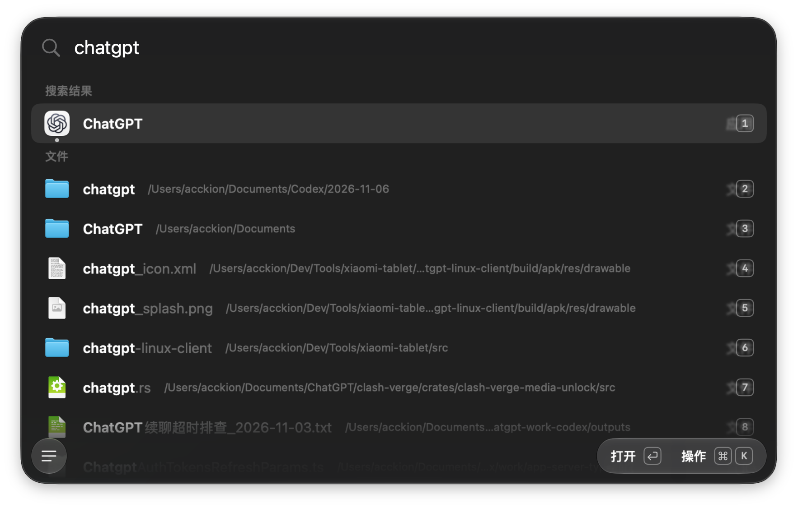
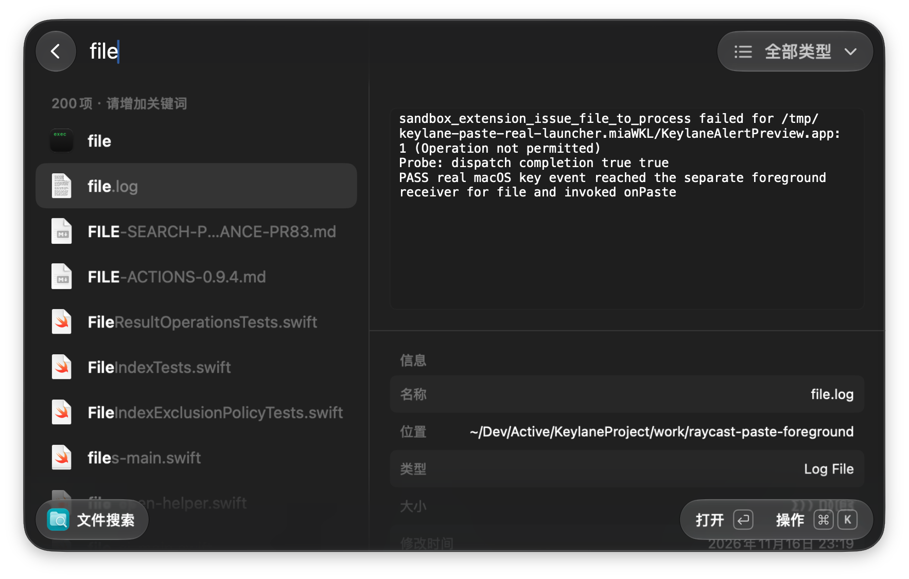
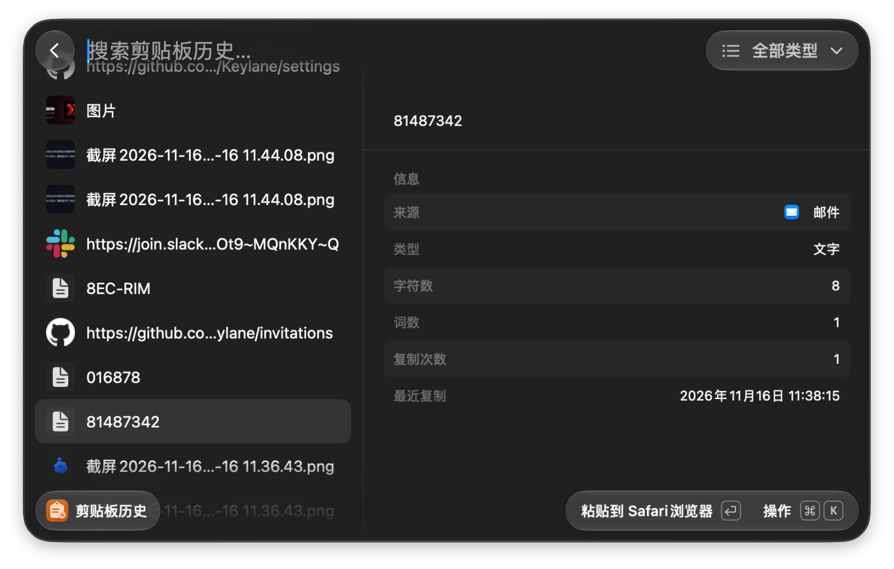

<h1 align="center">Keylane</h1>
<p align="center">From thought to action. Completely free and open source.</p>
<p align="center">A native keyboard launcher for macOS. Your apps, files, and everyday tools in one search window.</p>
<p align="center"><a href="README.md">简体中文</a> · <b>English</b></p>
<p align="center"><a href="https://acckion.github.io/Keylane/en/">Website</a> · <a href="https://github.com/Acckion/Keylane/releases">Download</a> · <a href="https://github.com/Acckion/Keylane/issues">Feedback</a></p>



Press **Option + Space** and type an app, file, or command name. Use the arrow keys to select, **Return** to open, and **Escape** to go back or hide the window. Start everyday tasks from the keyboard instead of switching between apps.

## One place for everyday tasks

### Find your apps and files

Search apps by name, Pinyin, or fuzzy matching, and keep favorites close at hand. File search combines Spotlight with local indexing. Filter by file type, preview contents and details, then open the action menu to work with your files.



### Find what you copied

Browse text, images, and files from your clipboard history. Search, filter, preview, and pin useful items, then copy them again or paste into the app you are using. Choose how long to keep your history and whether to save it between sessions.



### Small tools, fewer interruptions

- **Quick calculations**: type an expression, view the result, and copy it.
- **Words and symbols**: look up words in system dictionaries and search Emoji and symbols.
- **System and windows**: find system settings, run common system actions, switch windows, and arrange layouts.
- **Local information**: view calendars, search contacts, find screenshots and OCR text, and connect Apple Notes.
- **Your workflows**: run Apple Shortcuts and scripts, use Quicklinks and snippets, and assign command aliases and shortcuts.
- **Configuration migration**: back up and restore Keylane settings, or import supported preferences, command mappings, and Quicklinks from Raycast. Preview changes before importing; unsupported items are skipped.

## Completely free. Open source.

**Keylane is completely free, with no subscription or paid feature tiers.** Current source is available under [GPL-3.0-or-later](LICENSE): inspect it, modify it, build it yourself, and use or redistribute it commercially under the license terms. Third-party AI services you connect may charge separately.

### Compared with Raycast and SuperCmd V2

| | Keylane | Raycast 2 | SuperCmd V2 |
| --- | --- | --- | --- |
| UI and architecture | Native Swift + SwiftUI / AppKit UI | Swift / AppKit host, React / TypeScript in WKWebView, Node.js backend, and Rust core | Native Swift UI with AppKit / SwiftUI |
| Pricing | Completely free; no subscription or paid tiers | Free core features; subscriptions for Pro and other premium features | One-time purchase with a 7-day trial |
| Open source | Current source: GPL-3.0-or-later | Proprietary main app; open-source extension repository | V2 source is not public; V1 is the free, open-source version |
| Everyday tools | App and file search, clipboard, calculator, window actions, and more | Free core launcher tools and extensions | Native Swift launcher with everyday tools and AI integrations |
| Raycast extensions | Full compatibility is not currently offered | Official extension ecosystem | Most extensions supported, according to its website; some authentication methods are unsupported |

**Native UI, built for a lightweight experience.** Keylane builds its launcher directly with SwiftUI and AppKit rather than hosting its main interface in a WebView, reducing the main UI’s dependence on a web runtime. SuperCmd V2 also takes a native Swift approach. Raycast 2 uses a native host with a web-based UI, not Electron. Raycast 1 originally used Swift / AppKit for its core interface; the versions should not be conflated. See [Raycast’s architecture overview](https://www.raycast.com/blog/a-technical-deep-dive-into-the-new-raycast).

Architecture alone does not establish a performance ranking. Launch speed, search latency, and memory use depend on versions, data, and enabled features. No unmeasured speed or memory multiplier is claimed here.

Keylane is for people who want free everyday tools and access to the application's source code. It is not a feature-for-feature replacement for all of Raycast and its extensions.

Sources: [Raycast pricing](https://www.raycast.com/pricing), [software terms](https://www.raycast.com/terms-of-service), [open-source extensions](https://github.com/raycast/extensions), and the [SuperCmd website](https://supercmd.sh/) (November 16, 2026). Refer to each product's current documentation for plans and features.

## Move from Raycast

Keylane can import **`.rayconfig` exports** and **Quicklinks JSON** from Raycast.

1. [Export your configuration](https://manual.raycast.com/settings) from Raycast.
2. In Keylane, open **Settings → Advanced → Migrate from Raycast** and select the file. Enter the backup password when prompted for an encrypted export.
3. Review the import preview and conflicts, choose whether to keep existing settings or replace conflicting items, then confirm and fully quit and reopen Keylane.

| Supported data | Scope |
| --- | --- |
| Quicklinks | Names and links; unsupported placeholders or targets are skipped |
| Basic preferences | Supported appearance, window mode, navigation, return delay, and related settings, plus the launcher hotkey |
| Command settings | Aliases, enabled states, and supported hotkeys for precisely matched built-in commands and discovered apps |

## What’s next

Keylane will continue improving everyday workflows and gradually add more useful features found in Raycast and SuperCmd. Extension compatibility, additional AI tools, and workflow capabilities are planned areas of development, not features available today or a promise of full compatibility. See the [roadmap](docs/TODO.md) for direction.

## Installation

Requires **macOS 26 or later**. Current installers target Apple Silicon; Intel and universal binaries have not been verified.

1. Download the DMG and SHA-256 checksum file from [Releases](https://github.com/Acckion/Keylane/releases).
2. Verify the checksum, open the DMG, and drag Keylane into Applications.
3. Open Keylane and press **Option + Space**. Grant access to individual features when you need them.

Build from source to use Raycast configuration migration; the current Beta 1 installer does not include it.

The current public installer is **1.0.2 Beta 1**. It is ad-hoc signed, not Apple notarized, and requires manual installation. macOS may block the first launch. Read [Apple’s safety guidance](https://support.apple.com/en-us/102445) and proceed only if you trust the download source.

## Data and permissions

- **Stored locally**: settings and history stay on your Mac. There is no built-in telemetry or cloud sync. Clipboard history can contain sensitive information; choose persistence and retention settings accordingly.
- **Access when needed**: file search uses folders you select. Automatic paste and window actions may require Accessibility access; some integrations require Automation or access to the relevant data.
- **AI is your choice**: File AI sends your question and selected context to your configured provider only when you submit it. Context may include file names, paths, or contents. The provider’s fees and data policies apply. API keys are stored in macOS Keychain.

## Build from source

Keylane is built with **Swift, SwiftUI, and AppKit**. You need macOS 26+, a Swift 6 toolchain, and Python 3. SQLite uses the system library.

```sh
git clone https://github.com/Acckion/Keylane.git
cd Keylane
git switch dev
swift test
swift build -c release
bash scripts/package.sh
```

Packaging uses your configured signing identity. For local testing without a developer certificate, use ad-hoc signing:

```sh
KEYLANE_ALLOW_ADHOC=1 bash scripts/package.sh
```

Ad-hoc signing is not Apple notarization, and updates may require permissions to be granted again. See [signing and upgrade permissions](docs/SIGNING.md).

## Contributing

Issues and suggestions are welcome. Please include your macOS version, reproduction steps, and sanitized error information.

Before contributing, read the [contribution guide](CONTRIBUTING.md), [project guidelines](AGENTS.md), [code of conduct](CODE_OF_CONDUCT.md), and [security policy](SECURITY.md). Feature branches target `dev`; stable snapshots then move to `main`. See the [roadmap](docs/TODO.md) for development plans.

## Acknowledgments

Keylane’s concepts and interaction design were inspired by [SuperCMD V1](https://supercmd.sh/en/v1) and [Raycast](https://www.raycast.com/). Development also referenced SuperCMD V1 public source and observable clipboard data organization, persistence, and processing behavior in the distributed Raycast app when implementing Keylane.

## License

Current source is licensed under **[GPL-3.0-or-later](LICENSE)**, permitting use, modification, and redistribution, including commercial use, under its terms. Third-party components and data retain their own terms; see [third-party notices](THIRD_PARTY_NOTICES.md).

Historical tags and installers retain their bundled licenses, including the PolyForm Noncommercial license shipped with 1.0.2 Beta 1. The current license does not retroactively change older versions.
