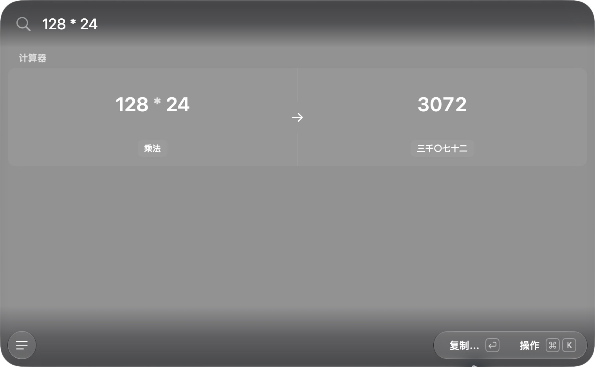

<p align="center"></p>
<h1 align="center">Keylane</h1>
<p align="center">From thought to action. A native keyboard launcher for macOS.</p>
<p align="center"><a href="README.md">简体中文</a> · <b>English</b></p>
<p align="center"><a href="https://acckion.github.io/Keylane/en/">Website (available after Pages setup)</a> · <a href="https://github.com/Acckion/Keylane/releases/tag/v1.0.2-beta.1">Download Beta 1</a> · <a href="docs/TODO.md">Roadmap</a></p>



Press **Option + Space** to open the search window. Type an app, file, or command name, select with the arrow keys, and press Return to open. Escape goes back or hides the window. Built with Swift, SwiftUI, and AppKit.

## Before you install Beta 1

The public download is **1.0.2 Beta 1 · build 27 · `891ab2c`**, requiring **macOS 26+ and Apple Silicon**. Intel and universal builds are unverified. This installer is **ad-hoc signed, not Apple notarized, and requires manual installation**.

1. Download the DMG and SHA-256 file from the [Beta 1 release page](https://github.com/Acckion/Keylane/releases/tag/v1.0.2-beta.1) and verify the checksum.
2. Open the DMG, drag Keylane to Applications, and open it from there.
3. macOS may block first launch. Read [Apple’s safety guidance](https://support.apple.com/en-us/102445). Automatic installation requires notarized Developer ID artifacts; install this release manually.

First launch under default security settings, upgrading from Alpha, isolated launch/quit/relaunch, and synthetic configuration upgrades remain unverified. The latest real-focus Navigation recheck did not pass. Installed keyboard and permission flows, multiple displays, full screen, Spaces, and real target apps still have validation gaps. Passing CI or isolated tests does not complete that acceptance.

> **Licensing depends on the version:** current dev source uses GPL-3.0-or-later, permitting commercial use under its terms. Beta 1 (`891ab2c`) and the pre-sync main snapshot (`877ca22`) retain their shipped PolyForm Noncommercial license. The GPL migration does not retroactively relicense old tags or installers.

## Everyday capabilities

| Entry point | Available in the released Beta | Boundaries |
| --- | --- | --- |
| Apps | Name, Pinyin and fuzzy search; favorites | Some input method and display interactions await acceptance |
| Files | Spotlight, supplemental local indexing, folder and content search | Requires folder access and depends on indexing state |
| Clipboard | Text, image and file history; search, pinning and retention | Opt in; automatic paste needs permissions and target-app testing |
| Tools | Calculator, Emoji and symbols, Quicklinks, script commands and snippets | System interactions require scenario-specific validation |
| System integrations | Shortcuts, calendar, contacts, screenshot search and OCR | Depend on authorization and actual data sources; acceptance gaps remain |


Screenshots show an actual Beta 1 app copy with fixed demo inputs. The app UI is Chinese. See [website evidence and isolation boundaries](docs/WEBSITE.md).

**In development, outside this Beta:** Raycast extension compatibility, configuration migration, and iPhone app launching. Development branches and draft PRs do not imply released features. See the [roadmap](docs/TODO.md) and [feature inventory](docs/FEATURES.csv).

See the [configuration migration scope and validation](docs/CONFIGURATION-MIGRATION.md) for the development version.

## Build from source

Requires macOS 26+, a Swift 6 toolchain (usually supplied by Xcode), and Python 3. SQLite uses the system library.

```sh
git clone https://github.com/Acckion/Keylane.git
cd Keylane
git switch dev
swift test
swift build -c release
bash scripts/package.sh
```

Packaging uses your configured signing identity. Without a certificate, local testing can explicitly use:

```sh
KEYLANE_ALLOW_ADHOC=1 bash scripts/package.sh
```

An ad-hoc update may require permissions to be granted again. It is not Developer ID signing or notarization. See [signing and upgrade permissions](docs/SIGNING.md).

## Data and permissions

- Data lives in local Application Support/Keylane and preferences. Clipboard history may contain sensitive data; choose persistence and retention deliberately.
- File access is limited to selected scopes. Automatic paste may require Accessibility; reading Finder selections may require Automation. Denying access affects the corresponding feature.
- There is no built-in telemetry or cloud sync. File AI sends your question and selected context to your configured provider only when you submit it. Context may include file names, paths or contents. Provider fees and data policies apply.
- AI keys are stored in macOS Keychain. Never commit keys, certificates, user databases or personal files.

## Project structure

```text
Sources/Keylane/          UI, system integration and controllers
Sources/KeylaneCore/      Search, storage and core logic
Tests/KeylaneCoreTests/   Automated core tests
Tests/Integration/       Isolated integration entry points
scripts/                 Packaging, signing and verification
website/                 Bilingual static GitHub Pages site
docs/                    Design, evidence and roadmap
```

Historical records in docs describe their state at the time. Automated or isolated verification does not replace actual accounts, target apps, or complete installer acceptance. Research material, third-party distributions, build caches and local signing configuration are excluded from the repository’s releases.

## Inspiration and acknowledgments

Keylane’s concepts and interaction design were inspired by [SuperCMD V1](https://supercmd.sh/en/v1) and [Raycast](https://www.raycast.com/). Development also referenced SuperCMD V1 public source and observable clipboard data organization, persistence and processing behavior in the distributed Raycast app when implementing Keylane.

## License

Current source uses **GNU General Public License v3.0 or later (GPL-3.0-or-later)**; see [LICENSE](LICENSE). It permits use, including commercial use, modification and redistribution under its terms. Distribution of original or modified versions requires compliance with applicable license, source and copyright notice obligations. A separate project commercial license is no longer required for these GPL versions.

This applies to code versions containing the license change, not old tags or previously released installers. Third-party components, data and system frameworks retain their own terms; see [THIRD_PARTY_NOTICES.md](THIRD_PARTY_NOTICES.md). The project license grants no rights to third-party brands or artwork.

## Contributing and development

Read [CONTRIBUTING.md](CONTRIBUTING.md), [CODE_OF_CONDUCT.md](CODE_OF_CONDUCT.md), [SECURITY.md](SECURITY.md), and [AGENTS.md](AGENTS.md). Report your system version, reproduction steps and sanitized errors. Run swift test before contributing and distinguish automated checks from actual interaction results.

Contribute only material you have rights to submit, without private third-party code, brand assets, or personal data. Original contributions must be distributable under GPL-3.0-or-later; preserve third-party licenses and attribution. Submitting a patch does not transfer copyright.

Feature branches target dev. After validation, synchronize a stable snapshot through a same-repository dev → main PR. Ordinary synchronization needs neither a release title nor a version/build bump and creates no tag or Release.

[CI](.github/workflows/ci.yml) retains Checks and validates version policy, scripts and Swift tests on PRs and dev/main pushes. Packaging-related changes also build and verify an ad-hoc signed, non-notarized test DMG. A manual CI run can request this with `validate_installer`. Ordinary CI uses no distribution secrets and does not publish software.

Software publication uses the separate [Release](.github/workflows/release.yml) manual entry: select main and provide that commit’s full `target_sha`. The candidate in [version.json](version.json) must exceed previous stable versions and all public build numbers, with release notes in `docs/releases/vX.Y.Z.md`. The workflow fixes that commit, reruns checks, builds, signs with Developer ID, notarizes and verifies the DMG before creating the tag and GitHub Release with the DMG and SHA-256. Missing distribution secrets fail closed. See [CI and release operations](docs/CI-RELEASE.md).

The static Pages workflow is independent of application CI/release, deploys website content only from main, and creates no software tags, Releases or application release assets. See [website maintenance and verification](docs/WEBSITE.md).
