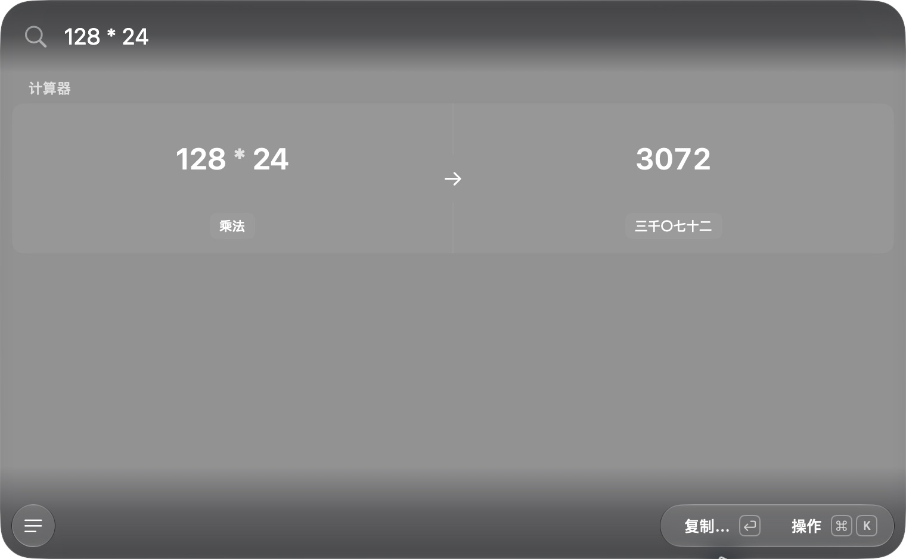

<p align="center"></p>
<h1 align="center">Keylane</h1>
<p align="center">想到，即刻开始。面向 macOS 的原生键盘启动器。</p>
<p align="center"><b>简体中文</b> · <a href="README.en.md">English</a></p>
<p align="center"><a href="https://acckion.github.io/Keylane/">产品官网（Pages 配置后上线）</a> · <a href="https://github.com/Acckion/Keylane/releases/tag/v1.0.2-beta.1">下载 Beta 1</a> · <a href="docs/TODO.md">开发计划</a></p>



通过 **Option + Space** 打开搜索窗口，输入应用、文件或命令名称。方向键选择，Return 打开，Escape 返回或隐藏。使用 Swift、SwiftUI 和 AppKit 构建。

## 先了解 Beta 1

公开下载为 **1.0.2 Beta 1 · build 27 · `891ab2c`**，要求 **macOS 26+、Apple Silicon**。Intel 和通用二进制尚未验证。此包使用 **ad-hoc 临时签名，未经 Apple 公证，需手动安装**。

1. 从 [Beta 1 发布页](https://github.com/Acckion/Keylane/releases/tag/v1.0.2-beta.1) 下载 DMG 与 SHA-256 文件，并核对校验和。
2. 打开 DMG，将 Keylane 拖到“应用程序”，再从“应用程序”打开。
3. macOS 可能阻止首次打开，请阅读 [Apple 安全说明](https://support.apple.com/en-us/102445)。应用内自动安装要求已公证的 Developer ID 产物，本包需要手动安装。

默认安全设置下首次打开、从 Alpha 升级、隔离启动/退出/重复启动和合成配置升级仍待验收。Navigation 本轮真实焦点复验未通过；安装版键盘与权限流程、多屏、全屏、Spaces 和真实目标应用仍有验证缺口。CI 或隔离测试通过不等于这些流程已验收。

> **许可分清版本：** 当前 dev 源码为 GPL-3.0-or-later，允许依条款商业使用。Beta 1（`891ab2c`）及同步前的 main 快照（`877ca22`）仍为其版本附带的 PolyForm Noncommercial 许可。GPL 迁移不追溯旧标签或安装包。

## 日常能力

| 入口 | 已发布 Beta 的能力 | 使用边界 |
| --- | --- | --- |
| 应用 | 名称、拼音与模糊搜索、收藏 | 部分输入法、多屏交互待验收 |
| 文件 | Spotlight、本地补充索引、目录与内容搜索 | 需目录授权，依赖索引状态 |
| 剪贴板 | 文字、图片、文件历史，搜索、置顶、保留策略 | 按需启用，自动粘贴需权限与目标应用验证 |
| 工具 | 计算器、Emoji 与符号、快捷链接、脚本命令、文字片段 | 系统交互按场景验证 |
| 系统集成 | 快捷指令、日历、联系人、截图搜索与 OCR | 依赖用户授权与实际数据源，仍有验收缺口 |


截图来自真实 Beta 1 应用副本，使用固定演示输入，应用界面为中文。来源与隔离边界见 [网站验证记录](docs/WEBSITE.md)。

**开发中，未随 Beta 提供：** Raycast 扩展兼容、配置迁移和 iPhone 应用启动。开发分支或草稿 PR 不代表已发布。详细状态见 [待办](docs/TODO.md)、[功能清单](docs/FEATURES.csv)。

## 从源码构建

需要 macOS 26+、Swift 6 工具链（通常由 Xcode 提供）、Python 3。SQLite 使用系统库。

```sh
git clone https://github.com/Acckion/Keylane.git
cd Keylane
git switch dev
swift test
swift build -c release
bash scripts/package.sh
```

打包默认使用本机配置的签名身份。无证书时，仅本地试用可选择：

```sh
KEYLANE_ALLOW_ADHOC=1 bash scripts/package.sh
```

临时签名升级可能需要重新授权，不代表 Developer ID 签名或公证。见 [签名与升级授权](docs/SIGNING.md)。

## 数据与权限

- 数据保存在本机的 Application Support/Keylane 及系统偏好设置中；剪贴板历史可能包含敏感内容，请按需开启持久化和保留策略。
- 文件访问范围由用户选择；自动粘贴等功能可能需要辅助功能权限，读取 Finder 选中项可能需要自动化权限。拒绝权限会影响对应功能。
- 没有内置遥测或云同步。文件 AI 会在用户主动提交时向所配置的服务发送问题及所选上下文，可能包含文件名、路径或内容；服务商可能计费，适用其数据政策。
- AI 密钥通过 macOS 钥匙串保存。不要提交密钥、签名证书、用户数据库或个人文件。

## 项目结构

```text
Sources/Keylane/          应用界面、系统集成及控制器
Sources/KeylaneCore/      检索、数据存储及核心逻辑
Tests/KeylaneCoreTests/   核心自动化测试
Tests/Integration/       隔离集成验证入口
scripts/                 打包、签名及验证脚本
website/                 中英静态 GitHub Pages 官网
docs/                    设计、开发记录、验证证据及待办
```

`docs/` 中的版本记录描述各轮当时的状态，不代表当前所有功能均已完成验收。自动化或隔离验证不能代替真实账号、真实目标应用及完整安装版交互验收。研究目录、第三方分发产物、构建缓存和本机签名配置不属于本仓库发布内容。

## 设计启发与致谢

Keylane 的功能构想与交互设计受到 [SuperCMD V1](https://supercmd.sh/en/v1) 和 [Raycast](https://www.raycast.com/) 的启发。开发过程中还参考了 SuperCMD V1 的公开源码，以及 Raycast 已分发程序中可观察到的剪贴板数据组织、持久化和处理机制，并据此编写 Keylane 的实现。

## 开源许可证

Keylane 采用 **GNU General Public License v3.0 or later（GPL-3.0-or-later）**，完整条款见 [LICENSE](LICENSE)。你可以在 GPL 条款下使用（包括商业使用）、修改及再分发本项目；分发原版或修改版时须遵守相应的许可证、源代码及版权声明义务。商业使用不再要求单独取得本项目的商业授权。

本许可声明适用于包含本次许可变更的代码版本，不追溯改写旧标签或已发布安装包的许可。第三方组件、数据和系统框架仍适用各自条款，相关声明见 [THIRD_PARTY_NOTICES.md](THIRD_PARTY_NOTICES.md)；本项目许可不授予第三方品牌或素材的使用权。

## 参与贡献

欢迎提交问题或改进建议。提交问题时请提供系统版本、复现步骤和经脱敏的错误信息。提交代码前运行 `swift test`，涉及系统能力时请区分自动化验证与实际交互结果。

贡献应为你有权提交的内容，不得包含第三方私有代码、品牌素材或个人数据。你提交的项目原创贡献应可按 GPL-3.0-or-later 分发；第三方内容必须注明来源并保留其原有许可。提交补丁不代表转让版权。

## 贡献与开发流程

请先阅读 [贡献指南](CONTRIBUTING.md)、[行为准则](CODE_OF_CONDUCT.md)、[安全政策](SECURITY.md) 与 [协作规范](AGENTS.md)。新任务从 dev 创建功能分支，通过 PR 合入 dev；完成必要验证后通过同仓库 dev → main PR 同步稳定快照。普通同步不要求 release 标题或版本递增，也不会创建 tag 或 Release。

[CI](.github/workflows/ci.yml) 保留 Checks，对 PR 和 dev/main push 检查版本、脚本并编译测试。改动打包相关文件时额外构建并验证临时签名 DMG；也可手动运行 CI 并勾选 `validate_installer`。测试包未经 Apple 公证。普通 CI 不使用发行 secrets，不发布软件。

正式发布使用独立 [Release](.github/workflows/release.yml) 手动入口：选择 main 并输入该提交的完整 `target_sha`。候选版本来自 [version.json](version.json)，版本须超过之前正式版，构建号须超过所有已公开版本，并提供 `docs/releases/vX.Y.Z.md` 发布说明。工作流固定该提交，重新测试、构建、Developer ID 签名、公证并验证 DMG 后，才创建对应 tag 和 GitHub Release，附带 DMG 与 SHA-256。发行 secrets 缺失会失败。详见 [工作流操作与验收](docs/CI-RELEASE.md)。

官网为静态 GitHub Pages，部署流程独立于应用 CI/发布，只在 main 部署网页，不创建软件标签、Release 或应用发行资产。配置与验证边界见 [官网维护说明](docs/WEBSITE.md)。
