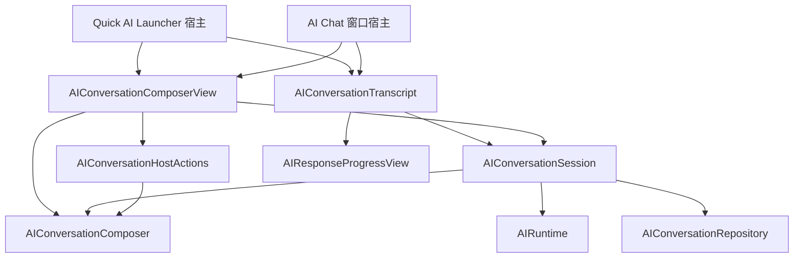

# Quick AI 与 AI Chat 的公共会话架构

## 集成范围

从 dev e84ae6b 集成 AI Chat（#191，cd5c9ac）和 Quick AI（#197，3120f6f）。保留已合入的 OpenRouter Key 修复，并整合最新 dev b4eb63b 的翻译扩展；公共生成接口同时保留翻译推理参数与聊天进度回调。此分支统一实现，不替原 PR 执行合并或发布。

Quick AI 是 Launcher 内的轻量聊天界面；AI Chat 提供独立窗口、历史侧栏、项目和检查器。两种界面使用同一个会话契约、草稿、消息、附件、生成过程和存储操作。界面决定布局与入口，不各自实现发送、附件拼接或请求重试。

## 依赖边界

- `AIConversationSession`：会话 ID、消息、当前模型身份、请求任务与代次、发送、停止、历史恢复、项目策略、编辑及分支。不访问窗口、弹窗或剪贴板。
- `AIConversationTurn`：共享持久化消息，包含问题、回复、附件和提供商公开进度。运行层输出事件，消息保存有限的进度数据；UI 不自行推断已执行工具。
- `AIConversationRepository`：串行数据库队列、记录和元数据；复制在队列执行时读取源最新信息；写入项目之前核对项目存在。保存、改名、移动、删除与恢复沿用原数据表。
- `AIConversationComposer`：唯一待发送草稿，包含文字、选区、附件、草稿代次、文件读取任务与错误。重置/发送/恢复历史使旧读取失效。偏好配置留在 `AIInteractionPreferences`，不混入草稿状态。
- `AIFileAttachment`：受限文件读取与旧记录解码；读取后转成通用 `AIConversationAttachment`，不再形成另一套待发送附件/消息协议。
- `AIConversationHostActions`：原生 sheet、复制、导出、链接和删除确认。系统窗口及焦点行为留在宿主，不塞回会话状态机。

## 公共 UI

两边实际引用同一个 `AIConversationComposerView`，包括左下角加号菜单、附件标签、原生输入框、@ 与斜杠菜单、文件/PDF 导入和错误处理。Quick AI 通过 compact 配置提供紧凑外观、Return 发送、空输入时使用回复和 Launcher Esc；完整聊天沿用聊天发送偏好及项目展示。

`AIConversationComposerMenu` 是统一的菜单面板；模型选项使用 `AIModelMenuCatalog` 的目录与排序。复制、粘贴、历史导航等 Launcher 专属动作继续通过 LauncherAction 展示，不把菜单容器强行替换成独立窗口样式。

`AIConversationTranscript` 和消息组件同时用于两边；思考、工具请求/运行/失败状态都使用 `AIResponseProgressView`，折叠展开逻辑只实现一次。未收到过程事件不伪造思考。工具请求继续区分未执行/运行/完成，不增加工具权限。

## 生命周期与行为

保留现有“一个活动对话从 Quick AI 继续到 AI Chat”的交互：宿主在 `AIModule` 中注入同一个 session，`beginChat` 明确切换展示目标；不读取数据库重建活动请求，不复制/重新发送问题，也不创建另一份草稿。已有请求、模型账户引用、消息 ID、未发送文字与附件保持。完整窗口活动时 Quick AI 命令继续路由到该窗口，避免同时出现两个编辑同一草稿的视图。

Session 不是全局单例；文字命令等独立入口可以创建自己的实例。窗口的侧栏展开、检查器、动作菜单等状态仍由窗口 presentation 对象持有。

- 所有消息均固定原模型/账户身份。两种展示可选择不同的空会话默认模型。
- 换模型使用同一 `chooseModel` 操作，由调用处明确 `.emptyOnly` 或 `.forkContinuation`。非空会话换模型建立分支，保留原记录。
- 重新生成和编辑统一通过 `resubmit`：先校验有效指令与附件，再保存原会话并创建分支；保留用户正在编辑的下一条草稿。Quick AI 不再原地覆盖历史回复。
- Quick AI 也持久化历史。上下文请求仍有预算，不能为裁剪请求而删除本地历史轮次。
- 显式离开/新建/关闭沿用原终止规则；暂时隐藏 Launcher、sheet 选择/取消不丢会话。`activeID`、历史代次与 `draftID` 分别隔离迟到网络、历史及附件结果。
- 原生输入开启 Undo/Redo；新草稿代次清除旧撤销栈，防止撤销恢复已发送/删除会话的文字。

## 兼容与性能

消息读取兼容 #191 的 `attachments`、#197 的 `files` 和无附件旧记录；旧文件转换成通用附件并保留 ID、名称和文字，之后统一编码为 `attachments`。设置键、数据库表、别名和命令 ID 不改，不访问用户数据库做迁移。

完成消息作为值视图比较。另一个消息的流式增量不会重新构建其 Markdown 和过程 UI。侧栏/检查器保留 #191 的分范围订阅；历史仅在提交、完成、停止和必要快照时保存，不在每个流式片段写库。未以这些结构变化宣称已测得 CPU 或滚动性能提升。

## 验证要求

合成传输、临时 SQLite 与临时文件验证旧字段兼容、附件导入/迟到结果、生成中继续到完整聊天不重复请求、草稿保留、分支/模型/项目与全部既有审查回归。原生输入、工具栏、Tab 路由和 sheet 使用隔离窗口测试。

实际安装版的两种窗口尺寸、菜单遮挡、中文输入法、系统听写、跨应用粘贴、真实账户与持续 CPU/滚动仍须实机验收。签名测试包与自动化结果单独记录；无真实模型请求不等于真实服务验收。

## 本轮自动化记录

- 46 组 AI 集成回归通过：模拟 HTTP/CLI、临时 SQLite、文本/PDF 文件解析、旧字段转换、草稿/请求转移、异步来源和所有既有审查边界。
- 最新整合版 264 项 Swift 核心/配置测试及 23 项分发脚本测试通过；翻译独立集成回归已通过。
- 原生共享编辑器验证 IME、UTF-16 光标、菜单方向键/Return/Esc、Undo/Redo、草稿代次清空撤销以及 Quick AI 的备选 Return 操作；原生窗口工具栏与 Tab 路由回归通过。
- 完整构建通过；Apple Development 签名 ARM64 测试 DMG 完成包校验。未安装、替换应用或发送真实模型请求。
- 文件选择器与系统书签测试需要正常系统服务访问；受限执行中的服务连接失败已在允许访问服务的隔离测试中重跑通过，未跳过或放宽断言。

审查补充：日历/剪贴板选择器携带打开时的草稿身份，草稿切换后关闭选择器并拒绝迟到结果；新增选择器请求回归通过。

Quick AI 回复区、滚动指示器与底部遮罩使用公共输入组件的实测高度预留空间，兼容多行输入、附件标签与错误提示，避免复用后固定底部留白遮挡最后一条回复。

窗口关闭只结束当前会话和草稿，不清空共用历史/项目目录；空白完整聊天关闭后，Quick AI 的历史导航和项目选择仍可使用，已补隔离回归。

公共回复字体由 `AIConversationMarkdownBody` 指定，段落、列表和标题统一随聊天缩放；实际 SwiftUI 渲染高度回归覆盖放大/缩小，并确认更新日志仍继承原字号。
