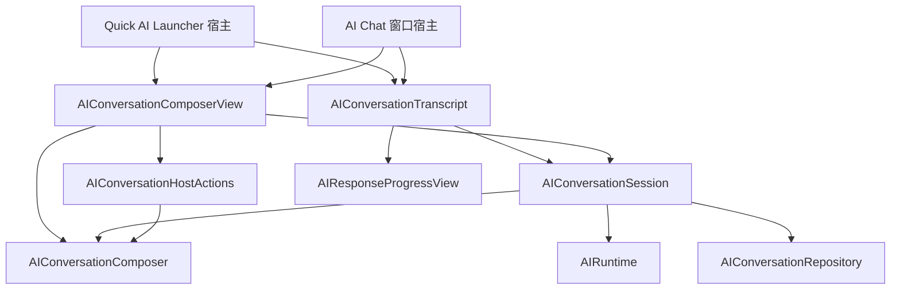

# Quick AI 与 AI Chat 的公共会话架构

## 集成范围

从 dev e84ae6b 集成 AI Chat（#191，cd5c9ac）和 Quick AI（#197，3120f6f）。保留已合入的 OpenRouter Key 修复，并整合最新 dev b4eb63b 的翻译扩展；公共生成接口同时保留翻译推理参数与聊天进度回调。此分支统一实现，不替原 PR 执行合并或发布。

Quick AI 是 Launcher 内的轻量聊天界面；AI Chat 提供独立窗口、历史侧栏、项目和检查器。两种界面使用同一个会话契约、草稿、消息、附件、生成过程和存储操作。界面决定布局与入口，不各自实现发送、附件拼接或请求重试。

## 依赖边界

- `AIConversationSession`：会话 ID、消息、当前模型身份、请求任务与代次、发送、停止、历史恢复、项目策略、编辑及分支。不访问窗口、弹窗或剪贴板。
- `AIRunHandle`：聊天与模块短动作共用的单次传输循环；会话仍负责历史和轮次，模块动作会话负责输入快照与来源校验。接入说明见 [模块 AI 动作](AI-MODULE-ACTIONS.md)。
- `AIConversationTurn`：共享持久化消息，包含问题、回复、附件和提供商公开进度。运行层输出事件，消息保存有限的进度数据；UI 不自行推断已执行工具。
- `AIConversationRepository`：串行数据库队列、记录和元数据；复制在队列执行时读取源最新信息；写入项目之前核对项目存在。保存、改名、移动、删除与恢复沿用原数据表。
- `AIConversationComposer`：唯一待发送草稿，包含文字、选区、附件、草稿代次、文件读取任务与错误。重置/发送/恢复历史使旧读取失效。偏好配置留在 `AIInteractionPreferences`，不混入草稿状态。
- `AIFileAttachment`：受限文件读取与旧记录解码；读取后转成通用 `AIConversationAttachment`，不再形成另一套待发送附件/消息协议。
- `AIConversationHostActions`：原生 sheet、复制、导出、链接和删除确认。系统窗口及焦点行为留在宿主，不塞回会话状态机。

## 公共 UI

两边实际引用同一个 `AIConversationComposerView`，包括左下角加号菜单、附件标签、原生输入框、@ 与斜杠菜单、文件/PDF 导入和错误处理。Quick AI 通过 compact 配置提供紧凑外观、Return 发送、空输入时使用回复和 Launcher Esc；完整聊天沿用聊天发送偏好及项目展示。

`AIConversationComposerMenu` 是统一的菜单面板；模型选项使用 `AIModelMenuCatalog` 的目录与排序。复制、粘贴、历史导航等 Launcher 专属动作继续通过 LauncherAction 展示，不把菜单容器强行替换成独立窗口样式。

`AIConversationTranscript` 和消息组件同时用于两边；思考、工具请求/运行/失败状态都使用 `AIResponseProgressView`，折叠展开逻辑只实现一次。未收到过程事件不伪造思考。工具请求继续区分未执行/运行/完成，不增加工具权限。

## 生命周期与行为

保留现有“一个活动对话从 Quick AI 继续到 AI Chat”的交互：宿主在 `AIModule` 中注入同一个 session，`beginChat` 明确切换展示目标；不读取数据库重建活动请求，不复制/重新发送问题，也不创建另一份草稿。已有请求、模型账户引用、消息 ID、未发送文字与附件保持。完整窗口活动时 Quick AI 命令继续路由到该窗口，避免同时出现两个编辑同一草稿的视图。

Session 不是全局单例；文字命令等独立入口可以创建自己的实例。窗口的侧栏展开、检查器、动作菜单等状态仍由窗口 presentation 对象持有。

- 所有消息均固定原模型/账户身份。两种展示可选择不同的空会话默认模型。
- 换模型使用同一 `chooseModel` 操作，由调用处明确 `.emptyOnly` 或 `.forkContinuation`。非空会话换模型建立分支，保留原记录。
- 重新生成和编辑统一通过 `resubmit`：先校验有效指令与附件，再保存原会话并创建分支；保留用户正在编辑的下一条草稿。Quick AI 不再原地覆盖历史回复。
- Quick AI 也持久化历史。上下文请求仍有预算，不能为裁剪请求而删除本地历史轮次。
- 显式离开/新建/关闭沿用原终止规则；暂时隐藏 Launcher、sheet 选择/取消不丢会话。`activeID`、历史代次与 `draftID` 分别隔离迟到网络、历史及附件结果。
- 原生输入开启 Undo/Redo；新草稿代次清除旧撤销栈，防止撤销恢复已发送/删除会话的文字。

## 兼容与性能

消息读取兼容 #191 的 `attachments`、#197 的 `files` 和无附件旧记录；旧文件转换成通用附件并保留 ID、名称和文字，之后统一编码为 `attachments`。设置键、数据库表、别名和命令 ID 不改，不访问用户数据库做迁移。

完成消息作为值视图比较。另一个消息的流式增量不会重新构建其 Markdown 和过程 UI。侧栏/检查器保留 #191 的分范围订阅；历史仅在提交、完成、停止和必要快照时保存，不在每个流式片段写库。未以这些结构变化宣称已测得 CPU 或滚动性能提升。

## 验证要求

合成传输、临时 SQLite 与临时文件验证旧字段兼容、附件导入/迟到结果、生成中继续到完整聊天不重复请求、草稿保留、分支/模型/项目与全部既有审查回归。原生输入、工具栏、Tab 路由和 sheet 使用隔离窗口测试。

实际安装版的两种窗口尺寸、菜单遮挡、中文输入法、系统听写、跨应用粘贴、真实账户与持续 CPU/滚动仍须实机验收。签名测试包与自动化结果单独记录；无真实模型请求不等于真实服务验收。

## 本轮自动化记录

- 46 组 AI 集成回归通过：模拟 HTTP/CLI、临时 SQLite、文本/PDF 文件解析、旧字段转换、草稿/请求转移、异步来源和所有既有审查边界。
- 最新整合版 264 项 Swift 核心/配置测试及 23 项分发脚本测试通过；翻译独立集成回归已通过。
- 原生共享编辑器验证 IME、UTF-16 光标、菜单方向键/Return/Esc、Undo/Redo、草稿代次清空撤销以及 Quick AI 的备选 Return 操作；原生窗口工具栏与 Tab 路由回归通过。
- 完整构建通过；Apple Development 签名 ARM64 测试 DMG 完成包校验。未安装、替换应用或发送真实模型请求。
- 文件选择器与系统书签测试需要正常系统服务访问；受限执行中的服务连接失败已在允许访问服务的隔离测试中重跑通过，未跳过或放宽断言。

审查补充：日历/剪贴板选择器携带打开时的草稿身份，草稿切换后关闭选择器并拒绝迟到结果；新增选择器请求回归通过。

Quick AI 回复区、滚动指示器与底部遮罩使用公共输入组件的实测高度预留空间，兼容多行输入、附件标签与错误提示，避免复用后固定底部留白遮挡最后一条回复。

窗口关闭只结束当前会话和草稿，不清空共用历史/项目目录；空白完整聊天关闭后，Quick AI 的历史导航和项目选择仍可使用，已补隔离回归。

公共回复字体由 `AIConversationMarkdownBody` 指定，段落、列表和标题统一随聊天缩放；实际 SwiftUI 渲染高度回归覆盖放大/缩小，并确认更新日志仍继承原字号。

## 基础工具运行层

`LauncherModule.aiTools` 登记 `AIToolRegistration`：纯声明、可用性、是否逐次确认与原生处理器分离。注册表统一拒绝重名；读取目录不执行处理器或申请权限。执行器保留本次目录快照，并在操作前、异步查询返回后核对模块启用状态和动态注册代次。禁用再启用不会复活旧操作。

Quick AI 与 AI Chat 的同一个 `AIConversationSession` 创建每次生成的 `AIToolRun`，共用设置开关、过程展示与 `AIToolApprovalBroker`。开关默认关闭；打开应用每次确认，60 秒未答复即拒绝。停止、换会话、关闭工具和更换连接使旧请求失效；确认与真正执行之间再次在主线程检查。并行请求按顺序执行，避免多个确认互相覆盖。

接入协议：

- OpenAI-compatible API、Ollama `/v1`、高级自定义提供方：函数 schema、多轮 assistant/tool 消息与 SSE 参数拼接；保留提供方额外续接字段。
- Anthropic API：原生 `tool_use/tool_result`，保留 assistant 原始块及 thinking signature，签名不显示到 UI。
- ChatGPT 订阅：Codex app-server 客户端 dynamic tools；RPC 必须匹配当前 thread/turn，返回原请求 ID。CLI 原生 shell、web 和外部 MCP 继续禁用。
- Claude 订阅：Claude Code SDK stream-json 控制协议，通过唯一 Keylane SDK MCP 服务提供 `tools/list`、`tools/call`；原生工具、用户 MCP、hooks 与 slash commands 继续禁用。收到取消控制消息时取消对应请求。订阅身份沿用既有连接检查。

每次生成最多 6 个模型往返、12 次工具执行，参数 16 KiB、单项结果 32 KiB、结果合计 128 KiB；CLI 单轮请求由 CLI 管理，仍受 12 次执行、总输出与超时限制。非法参数、未知工具、重复调用 ID、截断响应与超限均不会被当作成功。工具关闭时沿用原纯文字路径；模型明确不支持工具时显示错误，不静默降级。

首批工具包括时间、计算器、应用名称查找、确认后打开应用、已授权本地补充索引的文件名查询、已授权且已选中日历的七天内日程查询。文件工具明确标注索引覆盖范围，不读取正文；两种查询均不修改当前页面的查询、选择或预览。此阶段未接入任意命令执行、文件写入与第三方工具自动发现。

协议集成使用模拟 HTTP、隔离 CLI、虚构账户；通过自动化不代表真实提供商和所有模型已实测。真实账户、模型能力、安装版交互仍需单独验收。

OpenRouter 的流式续接分别处理文本/摘要增量和不可拆解的加密块；加密块保留原顺序、标识和内容，不拼接或展示到界面。协议依据：[OpenRouter reasoning_details](https://openrouter.ai/docs/guides/best-practices/reasoning-tokens#reasoning_details-array-structure)。

普通 OpenAI 响应、Anthropic 响应和工具响应共用 `AISSEEventDecoder` 分帧：逐字节保留 UTF-8，兼容 LF、CR、CRLF，多条 `data:` 在空行后才组成 JSON 事件。各协议在自己的结束标记处停止读取，避免等待仍开放的连接；公共组件限制单事件大小，传输层限制总响应大小。

## 输入区的宿主布局

`AIConversationComposerView` 继续共用草稿、原生编辑器、附件及 @ / 命令菜单。`ConversationComposer` 按语义样式适配外壳：AI Chat 单行输入区高 48pt、半圆端部，左侧独立等高 48pt 加号；Launcher 恢复原来的 36pt 输入区，左右各留出宿主底部按钮及间距，不再内置第二个加号。两边的圆形入口共用 `ConversationFooterButton`，Launcher 仍负责菜单展开与原有操作。

编辑器的最小高度由宿主样式提供，文字边距按原生字体行高居中计算；多行输入向上增长，操作按钮与最后一行保持同一中心。占位文字由原生编辑器根据实际文本与中文组合状态绘制，避免未提交的拼音/汉字与占位文字重叠。文字和宿主尺寸未变化时不重新安排输入高度，避免回复流式更新反复触发布局。

`verify-ai-composer-layout.sh` 使用真实共享外壳与原生编辑器验证两种宿主的单行、多行尺寸、按钮中心和左右留位，可选捕获合成内容窗口；`verify-ai-chat-input.sh` 复验中文组合、菜单快捷键、回车策略、焦点与 Undo/Redo。隔离窗口截图用于组件验收，不代表已替换安装版或通过真实模型测试。

加号展开菜单和 Launcher 共用 `LauncherActionMenuPanel`、`LauncherMenuRow`、`SearchField` 与 `LauncherMenuSurface`，固定为标题、操作列表、底部搜索。AI Chat 菜单从加号底边向上展开；@ 和 / 保留紧凑补全列表。

`LauncherExpandingMenu` 共用按钮与菜单的持久容器，按 `LauncherMenuSurface` 的 0.2 秒 smooth 动画从固定底角展开、收起，并尊重减少动态效果。Chat 只保留闭合按钮的布局占位，菜单扩展不会推动输入框；补全列表不使用该展开动画。

Chat 展开菜单通过共用容器可选的 `MenuOutsideClickDismissal` 在自身窗口内监听点击，点击内部不收起，点击外部收起并继续传递原事件；失去窗口焦点或应用退到后台也会关闭。监听仅在展开期间存在，收起、移除视图后释放，不申请全局输入权限。外部点击不请求编辑器焦点，Esc 仍返回编辑器；Launcher 保留宿主已有的外部点击关闭处理。

只读工具第三批在原有文件名查询上增加临时引用及逐次确认的正文读取，并让剪贴板模块贡献文本历史搜索／读取。`AIToolRunScope` 保存当前请求内的能力，`forRun()` 冻结功能代次；模块业务负责范围及文件版本核对。工具宿主继续负责确认、取消和额度，不接入模块 switch。限额、样板和待实机验收边界见 [模块 AI](AI-MODULE-ACTIONS.md) 与 [第三批验证](AI-READ-TOOLS-VALIDATION.md)。
