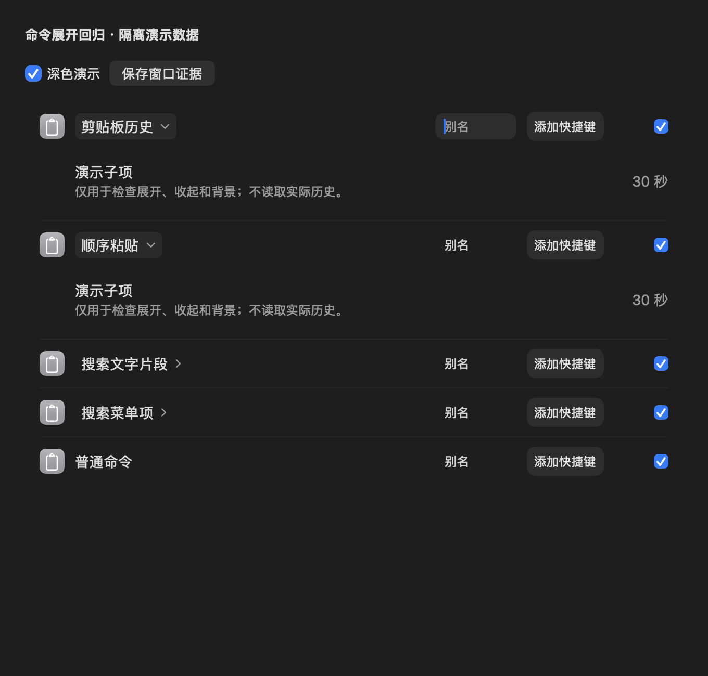
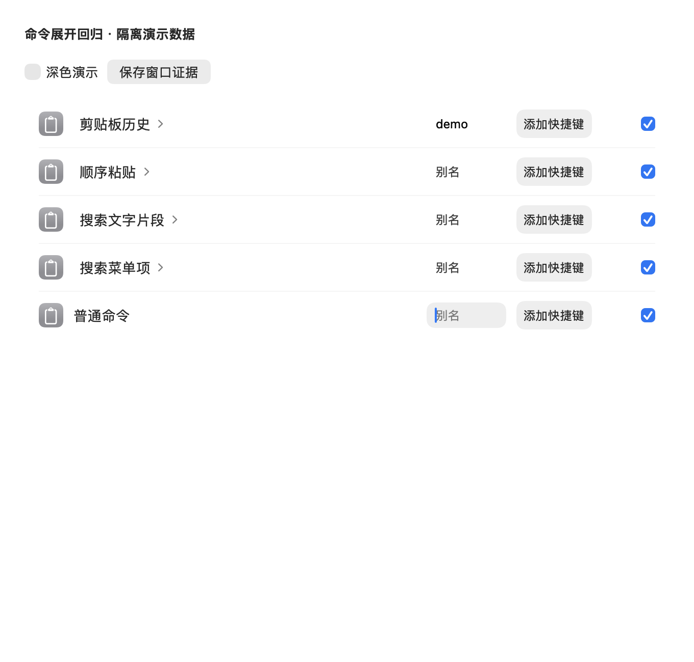

# 命令标题展开背景回归（#117）

## 范围

最新反馈要求标题背景只在展开时出现。已在本 Mac 下载并查看
[用户截图](https://github.com/user-attachments/assets/e106b5a8-799d-43be-8c08-f2a6454959cf)
的实际像素；截图里的两个标题均有圆角背景，文字反馈明确要求收起时隐藏。
PR #129 已接入行内设置，本次不改其子项或菜单应用排除功能。

`CommandSettingsRow` 原先无条件绘制标题背景，现在直接根据同一个
`CommandSettingsDisclosure.isExpanded` 绑定选择 0.07 或 0 的透明度。
保留原有颜色、圆角、内边距、按钮样式、箭头、辅助功能展开状态及别名焦点样式。
剪贴板历史、顺序粘贴、搜索文字片段和搜索菜单项都复用此组件。

## 可重复的隔离实机检查

```sh
mkdir -p /tmp/keylane-disclosure-evidence
KEYLANE_UI_EVIDENCE=/tmp/keylane-disclosure-evidence bash scripts/verify-command-settings-ui.sh
```

脚本编译实际生产源码，仅在临时副本中替换应用入口。窗口使用生产
`CommandSettingsList` 和内存演示条目，不创建 `Model` 或 `Delegate`，
不读取个人设置、数据库或剪贴板，不启动后台采集，不注册全局快捷键。
演示子项只用于显示布局，不能据此声称实际设置页的所有子项都通过验收。
关闭验证时在启动脚本的终端按 Ctrl-C；脚本清理自己的临时构建目录。

验收步骤：

1. 四个标题初始均收起，无标题背景；普通命令没有展开箭头。
2. 逐个点击四个标题，核对子项、向下箭头、标题背景与辅助功能状态同步。
3. 每个标题重复展开、收起三轮，检查背景不会残留，其他行状态互不影响。
4. 混合展开与收起，检查背景只跟随对应标题；普通命令不出现背景。
5. 检查别名输入的焦点背景、命令启用复选框和标题键盘操作。
6. 使用窗口内的深色演示开关重复检查深浅外观；不修改系统外观。
7. 点击「保存窗口证据」保存窗口内容 PNG，图片只含演示数据。

此脚本是交互检查工具，启动成功不等于验收通过。

## 2026-11-16 本 Mac 结果

环境：Apple Silicon、macOS 27.3（26C5035r），dev 基线 `69d203f`，
版本 1.0.2 / build 27。生产行为只修改标题背景的一行。

| 验证 | 结果 |
| --- | --- |
| 四类标题初始收起、普通命令 | 无标题背景；普通命令无展开箭头 |
| 四类标题展开 | 背景、向下箭头、演示子项和 AX「已展开」同步 |
| 深色每行收起/展开三轮（共 24 次切换） | 通过；AX 状态逐次核对，收起无背景残留 |
| 浅色每行收起/展开一轮 | 通过；背景只跟随对应行 |
| 混合状态、全部收起 | 通过；其他行状态不被改变 |
| 别名焦点及输入、Tab/Shift-Tab 字段移动 | 通过；焦点背景保留，演示别名只存内存 |
| 启用复选框关闭/恢复 | 通过；不改变展开状态 |
| 版本检查、18 项 Python 测试 | 通过 |
| 161 项 Swift XCTest | 原生 Mac 运行全部通过 |
| 临时签名 Release 构建、DMG 及包校验 | 通过；不是 Developer ID 签名或公证 |

最初受限沙箱中有两个命名剪贴板测试报 8 个断言失败，原生运行全部通过；
首次受限 Release 构建被阻止生成 dSYM，原生重跑完成构建与包校验。

以下图片由上述原生窗口内容直接保存，仅含内存演示数据；不是设计稿或模拟截图。

深色混合展开状态（同时可见别名焦点背景）：



浅色全部收起（demo 是临时输入的演示别名）：



未验证：安装版四个实际设置页的完整子项、设置搜索跳转、VoiceOver 朗读、
标题按钮的 Tab/Space 操作。本机默认 Tab 导航在文本字段之间移动，
未为测试改变系统键盘导航设置。已检查 AX 展开状态，但不能替代 VoiceOver 验收。
本次保留 issue #117，等待安装版最终验收；没有重做或验证菜单排除及粘贴等系统功能。
