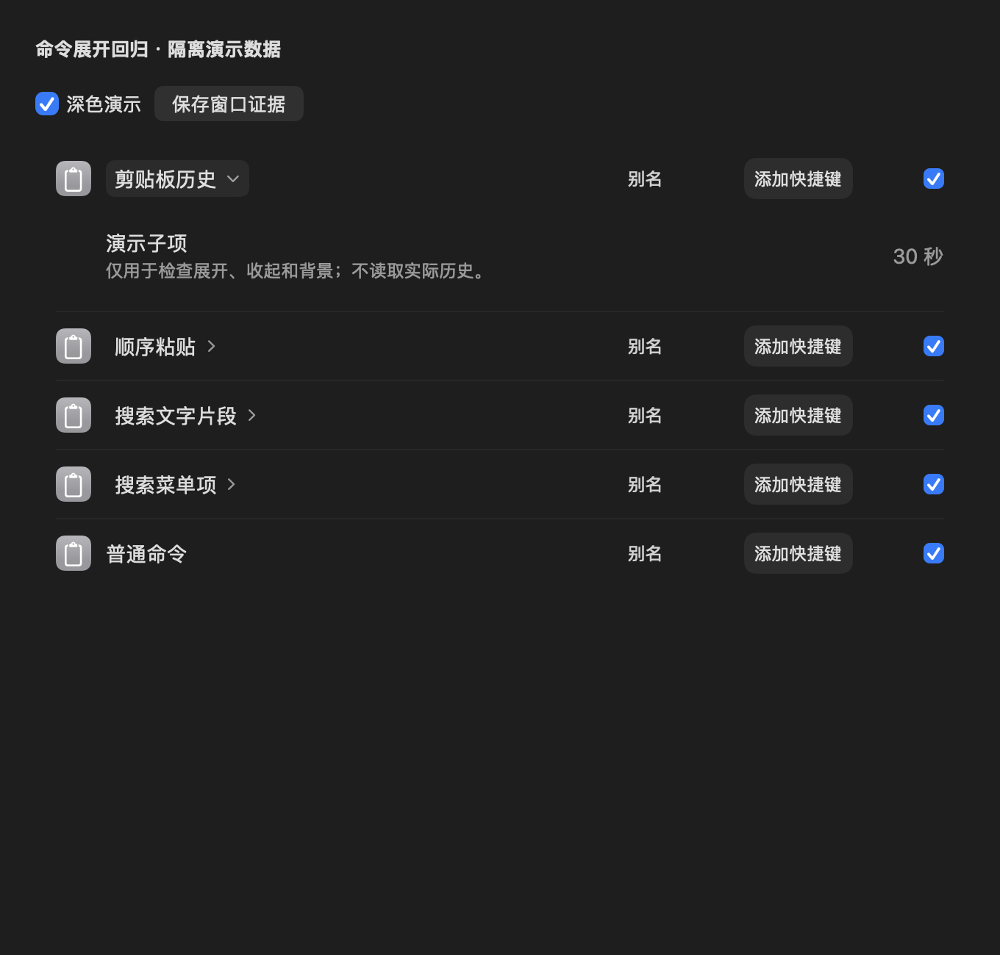
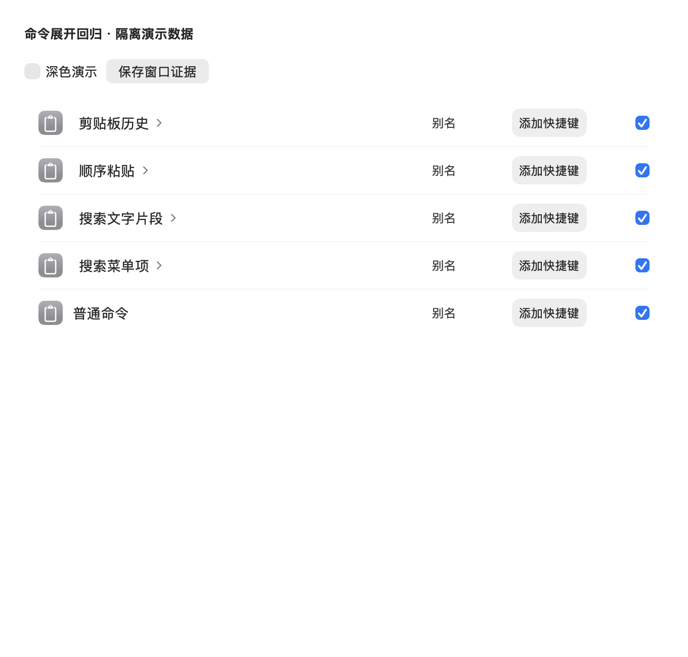

# #117：命令标题与展开指示器的命中区域

对应[新验收反馈](https://github.com/Acckion/Keylane/issues/117#issuecomment-6908788732)。
基线为 dev `ace5f90`，已包含 #143 的背景修复。继续保留「仅展开时显示标题背景」。

## 原因与修复范围

纯样式按钮没有为其标签定义连续命中区域。文字和小号 chevron 的有效命中
不能覆盖整个标签内边距；标题背景收起后透明，该区域尤其不易点击。
本 Mac 的基线实测并非所有三角坐标都失败：三角中心可触发，但右侧内边距漏点。

`CommandSettingsRow` 在带内边距的标题标签上增加矩形 `contentShape`，
只覆盖文字、三角及其内边距，不把行末空白、别名、快捷键或复选框纳入按钮。
标题按钮显式接受键盘焦点，并仅在自身获得焦点时处理不带修饰键的 Space 按下。
禁用或不可用时不处理；按键重复不重复切换，返回 handled 防止重复响应。
没有添加全局 Space 快捷键或整行点击手势。

## 可重复回归

使用现有 `bash scripts/verify-command-settings-ui.sh`。窗口编译实际生产组件，
仅使用内存演示数据，不实例化 Model/Delegate，不读取个人剪贴板或偏好数据。
需要截图时先建立目录并传入 `KEYLANE_UI_EVIDENCE`；终端 Ctrl-C 退出。

1. 使用实际指针坐标点击四个标题的文字、三角中心及其右侧内边距；
   不得只使用 AXPress 验证，AXPress 会绕过具体命中区域。
2. 分别展开、收起并重复至少三轮，核对箭头、子项、AX 状态及标题背景。
   对同一行重复点击时保持其他行收起，避免用过期的垂直坐标。
3. 在每行别名中输入包含空格的演示文字，检查不改变展开状态；
   点击启用复选框、快捷键录制并取消，同样不能触发展开。
4. 从别名按 Shift-Tab 到标题，再按 Space 切换；Tab 返回别名。
   核对每次按键恰好切换一次、焦点环可见；保留系统键盘导航设置。
5. 在深浅外观下核对混合及全部收起状态，标题背景仅随展开状态变化。

## 本轮验证记录

本轮使用原生组件演示窗口验证命中和键盘交互。它不是安装版完整设置页，
不能证明实际页的完整子项、设置搜索跳转或 VoiceOver 朗读已经验收。
安装版这些验收缺口继续保留，issue #117 保持打开。

### 2026-11-16 实测结果

环境：本 Mac / Apple Silicon / macOS 27.3，版本 1.0.2 build 27。
使用上述原生生产组件演示窗口；没有改系统键盘导航或安全权限。

基线窗口截图为 1360×1364 像素。第一行 chevron 中心约 `(316,307)`，
点击可切换；右侧内边距 `(320,307)`、`(325,307)` 无法展开。
最终代码在相同的 `(325,307)` 成功展开，背景只在展开时出现。
基线从别名 Shift-Tab 会跳到其他文本框；最终代码可到标题，并以 Space 切换。

| 行 | 三角中心 x | 右侧内边距 x | 全部收起时 y | 深色坐标点击 | 浅色坐标点击 |
| --- | --- | --- | --- | --- | --- |
| 剪贴板历史 | 316 | 325 | 307 | 3 轮 / 12 次通过 | 1 轮 / 4 次通过 |
| 顺序粘贴 | 288 | 297 | 401 | 3 轮 / 12 次通过 | 1 轮 / 4 次通过 |
| 搜索文字片段 | 343 | 352 | 495 | 3 轮 / 12 次通过 | 1 轮 / 4 次通过 |
| 搜索菜单项 | 316 | 325 | 589 | 3 轮 / 12 次通过 | 1 轮 / 4 次通过 |

每轮：内边距展开 → 三角中心收起 → 文字展开 → 文字收起。
文字点击 x=220；每次检查目标 AX 状态，深色回归同时检查其他行仍收起。
这些坐标只适用于本窗口尺寸及缩放，不应当直接套用到安装版页面。

四行分别通过：含空格的别名输入不触发展开；Shift-Tab 到标题；
Space 展开、再按 Space 收起；Tab 回别名后继续输入；启用复选框关闭/恢复不展开。
快捷键录制弹层打开后 Escape 取消也不展开。普通命令未添加展开按钮。
按键长按重复及不可用条目的禁用分支由代码明确过滤，本轮未另做长按/禁用实机测试。

最终代码验证：161 项原生 Swift XCTest、版本检查、18 项发行脚本测试、
差异检查及临时签名构建/DMG 校验通过。测试包没有安装替换、发布或公证。

截图由本轮原生窗口内容直接保存，仅含演示数据。蓝色边框是键盘焦点环，
收起时仍保留焦点环，不等于展开时的灰色标题背景。

