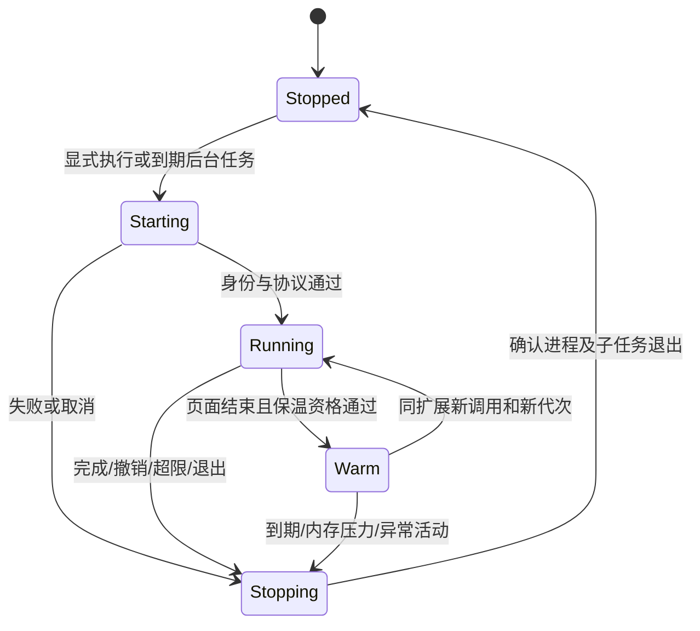

# macOS 扩展运行体系与 VM 移除设计

状态：M0首方可行性验收通过（受限JavaScriptCore）；原Node候选仍blocked。产品未接通；M1第一批构建契约／隔离编译已实现并首方验证，M1整体未完成，M2–M5未开始。2026-11-23。
关联：EXT-01、EXT-02、BASE-11；前序架构 #218 → #221 → #223，商店草稿 #222。

## 0. 当前有效决策与 M0 范围

2026-11-22 用户明确选择“允许受限 JavaScriptCore，明确兼容子集并逐步适配”。当前唯一候选改为系统JavaScriptCore；完整Node方案已被实测拒绝，不提供Node或VM fallback。第12–17节保留原始调查历史及失败，不能将其当作当前引擎已具备的能力。

M0验证**首方可行性原语**：签名、OS文件／网络／动态库边界、无原生能力的JS环境、受控通道、身份、撤权／退出、有界资源、持久CAS和编译输入不执行。它不等同M1的产品enrollment／不可变制品部署、M2的正式命令接入、M3的完整UI和持久内容适配，亦不等同第三方或Raycast全生态验收。完整M0条件与机器判定见 [终审记录](M0-ACCEPTANCE.md)。

威胁主体是恶意JS、畸形协议、过时代次及未经授权的进程；系统JSC和应用自己签名的原生代理属于可信计算基。不提供ObjC／FFI、任意native addon、shell或进程原语，并以OS Sandbox及Hardened Runtime补充隔离。不宣称能阻止所有引擎漏洞或任意原生RCE，不把“没有某个JS接口”写成“OS禁止该原生系统调用”。不承诺VM等强隔离。

## 1. 决策与当前基线

用户已确认取消 Linux VM 路径，构建与运行均迁到受控 macOS 进程；不保留可选 VM 后端。本方向先提交设计，再实施首方 M0 探针；目前未删除 VM 代码、不改变产品默认权限、不安装或启动第三方扩展。

设计基于已合入 dev `37dac2eb3f9a0d0a6817c2d6077f6614cd9ab88b`；#222 核对头为 `c7b419771a5196a65bd8894daa6c63fd3ce74f43`，仍为草稿，其 Store/Guest 文件尚未进入本工作树。实施前必须重新核对两端与并行工作，不能把本设计误报为 #222 已迁移。

#222 当前每次 build/run 使用全新 Linux VM，配置 1 vCPU/512 MiB，通过 virtio socket 连接宿主；无网络/共享目录，运行监督约 24 秒截止。商店生产切片仍为受限 no-view/反馈路径，不等于其他原型已验证的完整 API 兼容。512 MiB 不是实测物理占用。

目标是原生宿主 + 按需 macOS JavaScriptCore 扩展进程。内置模块保持原生实现，不因统一模块接口而转入 Node；第三方扩展沿用同一命令、页面、设置和动作注册入口。

## 2. 组件与边界

| 组件 | 职责 | 不承担的职责 |
|---|---|---|
| 商店/安装协调 | 固定源码、依赖完整性、用户安装确认、原子收据与回滚 | 不根据目录收录判定可运行，不执行扩展代码 |
| `ExtensionBuildService`（拟议） | 独立签名进程、固定编译器、隔离输入、构建摘要 | 不复用运行进程，不执行 npm 生命周期、插件或用户构建脚本 |
| `ExtensionRuntimeSupervisor`（拟议） | 进程准入、并发、状态、采样、撤销与终止 | 不执行 JS，不拥有第二套命令目录 |
| `MacOSExtensionProcess`（拟议） | JSC／显式API适配、React状态与命令执行 | 不直接承接宿主权限，不持有全局设置和用户资料目录 |
| 宿主能力代理 | 核对身份、安装/模块/访问代次，执行授权范围内的操作 | 不接受扩展自报 owner、任意路径或任意 shell 字符串作为权限 |
| 原生渲染适配 | 校验页面树、事件与动作，复用 Launcher 和设置组件 | 不为扩展另造行距、按钮、导航或 WebView UI |

上述名称为设计接口，尚无实现。首版只有 macOS 运行后端，不为假设中的 VM/其他平台增加插件式后端框架。构建与运行协议分离，使二者的权限和超时可以独立验证。

## 3. 进程与安全模型：必须先完成的可行性验证

初版每次调用使用全新JSC进程／上下文，不保温或复用JS全局。不同扩展不共享JS堆或模块缓存；同扩展命令切换先结束旧调用。后续并发和保温必须重新验证身份、清理和预算。

独立进程用于故障与资源归属，不是安全证明；Node `--permission`、API shim、拦截 require 和 V8 isolate 都不能替代抵御恶意代码的 OS 边界。取消 VM 明确失去原有的来宾内核隔离，不宣称等强安全性。

### M0 验证方案

当前候选是受App Sandbox约束的签名JSC helper，脚本只得到明确、有界的宿主代理；不加载Node。编译器作为另一固定签名进程继承构建helper限制，使用固定CLI输入／输出，不执行npm脚本、插件或扩展源码。普通宿主不整体开启App Sandbox。旧helper→Node候选只保留为失败证据。

需要分别验证helper、系统JSC及构建器的签名、沙箱继承和动态代码要求。只给确实需要的二进制最小 Hardened Runtime 例外，不把宿主设为无库校验/任意可执行内存，也不以 ad-hoc 签名作为本机安装方案。编译器与测试依赖从官方来源固定版本、摘要、许可并自行签署；JSC采用系统框架。不复用Raycast分发资源，不使用用户PATH中的Node。

默认禁止直接访问：宿主用户资料、其他扩展存储、Keychain、用户目录、网络、任意子进程、调试/进程控制及任意 native addon。后续允许的系统能力通过宿主代理提供。实际 OS 沙箱可见的系统只读资源、helper 自有容器等必须列入实测矩阵，不能声称“只有一个目录可见”而没有证据。

**特别约束：相同 helper 签名/Bundle ID 可能共享容器。** 不把一扩展一进程误当作一扩展一文件沙箱。持久存储、口令、其他扩展的输入和日志不放在共同可读的 helper 容器。代码/资源可由宿主按有界协议传入，优先预打包纯 JS 与资源表；临时文件、转储和跨运行残留必须验证。若 OS 边界无法排除共享容器中的跨扩展敏感残留，则改变文件布局/传输方案并重新验收，不能仅靠 JS 路径判断。

M0必须用合成探针区分验证：JS没有raw fs/network/process/native入口；原生负对照验证OS文件／网络／库校验及宿主服务边界；另测符号链接、FD、分区读写、身份、撤权、失联、崩溃与强制退出。不能只测代理层返回 denied；探针必须尝试绕开 shim。所有权限测试仅用首方探针与自建临时数据。

若公开受支持的机制无法满足边界，结果为 `runtimeUnavailable`，保持仅浏览，不静默启用普通 Node、不回退 VM、不使用弃用的 sandbox-exec/私有沙箱接口作为发布前提。需要改变信任模型时另行做明确产品决定。

## 4. 无 VM 的安装与构建

1. 宿主固定来源提交、manifest、依赖版本/摘要；下载和解包为有界数据处理，不执行包代码。
2. 解析平台为 darwin/目标架构。沿用拒绝逃逸路径、链接逃逸、安装钩子、未知 native 二进制等规则；不是把 Linux 检查改成 darwin 后放行全部依赖。
3. 构建服务只接收封装输入，使用应用控制的固定 esbuild 等工具和固定参数；不加载包提供的 JS 配置、esbuild 插件、npm prepare/install/postinstall 或任意命令。
4. 构建进程独立于运行进程，默认离线，不持有凭据。编译器处理不可信文本本身也必须处于已验证的 OS 边界。
5. 产出不可变制品、资源表、协议/API 版本、工具链/策略摘要、目标架构与内容摘要。宿主复验后才原子提交安装收据；来源/版本在确认后仍重新核对。
6. 失败或取消只清理本次 staging，不修改已安装制品、偏好和原有效版本。构建与运行不得接受 manifest 提供的解释器/编译器路径。

## 5. 注册、协议与权限代理

沿用 #223 的目录快照事务、稳定 ModuleID/CommandID/PageID、激活 UUID 和延迟注册协调。目录读取不启动进程、不获取用户资料、不申请权限。所有命令仍通过宿主统一执行器，不增加菜单/热键专用启动分支。

拟议身份链：`installationID + installationGeneration + catalogActivationID + processInstanceID + invocationID + pageVisitID? + capabilityEpoch`。由宿主从已验证收据创建，扩展不能自选。更新安装、禁用模块、撤销能力、结束页面分别撤销对应范围，不把一条页面查询取消误当作卸载整个扩展。

握手验证协议、API版本、运行时/制品摘要、进程身份。XPC 使用 audit identity；独立 helper 传输使用签名身份、受控继承通道和单次票据，不仅检查 PID（避免PID复用）。票据不放在可读日志或普通偏好中，不把“知道nonce”当作完整身份认证。

控制与数据通道采用明确 framing，stdout/stderr 只作有界诊断，不能混进协议。复用已有 frame/速率限制与重放检查；长会话不能无限累计消息，也不能直接把短任务的128条总预算套到长期UI。协议版本明确区分滑动限流、单动作额度、页面树节点数、图片/附件字节及队列上限。超限应取消/断开，不允许队列无限增长。

UI patch/action 每次核对当前会话；导航、Esc、回车和动作可用性沿用宿主页面约定。异步结果在应用前再次检查代次。能力代理在操作开始、返回以及对外披露前检查授权；失效后排队消息、旧回调和按钮全部拒绝。

| 能力 | 默认设计 |
|---|---|
| 反馈、页面树、动作 | 有界宿主调用；引用限定到当前实例/页面 |
| 偏好/LocalStorage/Cache | 宿主按安装身份分区，不让扩展传入其他 namespace |
| 密码偏好 | 宿主Keychain；只向已获授权的当前扩展披露所需值，不开放通用Keychain |
| 文件 | 用户显式授权范围，宿主处理路径/版本/书签，检查链接逃逸与撤权；不自动继承文件搜索所有权限 |
| 网络 | 单独能力，经宿主代理；连接/重定向、响应大小、取消、凭据和本机/私网访问策略均受控。首片无网络，需要支持后才标兼容 |
| Node fs/http/https 等 | 只承诺已实现并验证的适配子集；未适配的模块不能绕过代理，按命令报告缺口 |
| AppleScript、任意shell、native addon | 默认不支持，不为兼容偷偷放开；后续首方固定系统动作可作为独立能力评审 |
| 菜单栏、后台刷新 | 显式登记与用户启用，独立调度，不能由任意定时器获得后台常驻资格 |

Node fetch代理不等于所有npm网络库兼容，受控文件适配也不等于任意npm fs语义。保留现有OAuth例外，不在本次设计中擅自扩展范围。浏览商店、安装成功、API兼容、真实命令可运行分别记录。

## 6. 生命周期与取消

M1/M2 初版保温关闭，页面离开或命令完成即撤销并退出。M4 测试通过后才考虑30秒保温；不把上轮讨论的30秒当成已具备安全暂停的功能。保温不得拥有页面/网络/文件权限、旧消息和用户输入；协议暂停不足以停止恶意计算，若不能有效清理并监督空闲，直接结束进程。

- `no-view`：调用结束后释放会话；用户主动取消立即撤销。不使用全局24秒终止所有模式。
- `view`：页面存在期间可运行；查询使用独立取消token，新查询淘汰旧查询。返回/关闭时取消查询、审批、预览和动作，晚结果丢弃。
- `menu-bar`：分开登记菜单静态快照、点击动作与刷新任务。无需一直运行JS进程来显示图标；需连续状态的命令必须明确申报及单独验证，首片不开放该模式。
- 后台：默认不启动；显式启用后按任务调度，合并重复触发、限制并发。休眠不补发全部错过任务；唤醒重新核对可用性。
- 禁用/更新/卸载/宿主退出：先撤销身份和能力，再取消I/O，发送shutdown，宽限后终止；确认退出后才删除属于本安装的制品。
- 异常：有界错误展示；不自动重放有副作用动作。崩溃循环暂停自动调度，等待用户重试，不无限重启。
- 更新：在staging构建并验证新版本，停止/撤销旧实例后原子切换。候选准备失败保留旧目录和数据；切换后的业务副作用不承诺回滚。

首轮待测参数：启动握手5秒；普通宿主RPC15秒（用户审批等待单独计时）；构建60秒；shutdown宽限1秒。都是可校准参数，不是已测SLA。网络、长计算、审批和后台任务分别设限，UI整个寿命不受15秒上限约束。UI行为必须给出取消反馈。

## 7. 资源预算和归属

预算不是发布保证。原Node的40–180MiB估计不再适用于当前引擎；JSC产品预算待M4同负载采样。M0的64MiB RSS采样阈值只是首方压力实验，既非硬上限，也不能推断真实依赖、UI或总物理占用。

| 项目 | 首片策略 | 后续待测策略 |
|---|---|---|
| 未使用的已安装扩展 | 0专属进程；只保留元数据 | 不做全目录预热 |
| 并发 | 1前台命令，构建最多1个；后台关闭 | 最多2个前台/保温运行器，后台最多1个，总预算共同约束 |
| 保温 | 关闭，完成即退出 | 30秒候选；内存压力立即回收，LRU淘汰 |
| 内存 | 记录每进程phys_footprint及宿主增量 | 256 MiB/扩展、384 MiB总运行器为候选监督阈值；连续越线终止，非OS硬上限 |
| CPU | 不使用轮询维持实例；可取消计算 | 保温/隐藏静置接近零持续CPU；持续异常活动回收 |
| 缓存/队列 | 每安装限额、背压、有界日志 | 宿主统一LRU，不让进程各自无限缓存 |

统计包含宿主原生页面/图片增量、监督器、扩展进程和构建器，不能只看主进程。来源读取、JS计算和网络不在主线程执行。资源采样只针对活动进程，不引入常驻高频监控。没有“安装10个扩展就常驻10份Node”的设计。

## 8. #222 代码迁移清单

以下文件以 #222 固定头为参照，不表示它们已在dev。

| 当前模块 | 处理 |
|---|---|
| PublicCatalog/Source/依赖摘要/安装确认/收据与更新事务 | 保留；摘要加入新平台、工具链与策略版本 |
| `StoreRuntimeBridge` / `IsolatedEngine` | 保留准入和不可变制品语义；拆分BuildService与RuntimeSession契约，去掉fresh guest语义，不能仅把禁止host fallback的guard注释掉 |
| `StoreSignedGuestEngine` / `StoreGuestMain` / VZ驱动 | 替换并最终删除；新增签名macOS服务与身份验证 |
| `StoreGuestProtocol` / ticket / common authority / stop proof | 提取与VM无关的不变量，版本化为runtime协议；先移植旧负向测试，再删旧类型，不平行维护两套授权来源 |
| `ExtensionPrototypeSession` 及公开API适配 | 合并复用已验证能力和限额；不把测试适配器直接视为生产沙箱 |
| `RaycastStoreProductIngress` / AppCapability / release预检 | 保留缺配置时仅浏览；验证macOS helper／系统JSC链接／编译器签名、entitlements与固定资源 |
| guest kernel/initramfs、Linux PID1/seccomp、virtio socket、镜像recipe | 移除构建/发行依赖；用OS helper探针和生命周期测试替代 |
| `prepare_store_guest.py` / `store_guest_newc.py` / `store_guest_packaging.py` 及对应测试 | 删除VM专属部分，移植来源/摘要/许可/失败拒绝测试到macOS打包验证 |
| virtualization entitlement / Guest target及包配置 | 删除；仅在macOS替代签名路径验收后启用新发行入口 |
| Store偏好、别名/收藏/热键、LocalStorage及密码偏好 | 不更换稳定键、不删除数据；存储schema迁移另写版本与回滚记录 |

旧VM制品/收据不能直接在macOS运行。保留安装身份及用户偏好，把运行资格标为“需重新构建”；依据已固定来源进行显式升级，不能静默下载另一版本。旧引擎profile不可激活且不自动重入VM。清理只针对可验证属于应用的旧资源；不扫描/清除用户缓存、研究工作树、证书或历史文件。

## 9. 分批实施与退出条件

| 批次 | 交付 | 必须通过的验证 |
|---|---|---|
| M0 可行性 | 签名JSC／固定编译器首方探针，确定XPC／继承通道与数据布局 | OS权限绕过/跨扩展容器/进程后代/JIT/签名/退出探针；未通过不接通第三方代码 |
| M1 构建迁移 | 固定darwin工具链、离线构建、版本化收据、安装原子切换 | 无脚本/插件执行、依赖摘要、路径逃逸、取消、不覆盖有效安装；合成输入 |
| M2 运行迁移 | 无界面样板接入统一执行器、runtime身份与代理 | no-view首方样例；toast、普通偏好、复制按能力分别验证；旧票据/代次/迟到消息拒绝 |
| M3 原生UI和存储 | List/Detail/Form/Grid与导航/动作/持久存储，再接受控网络 | Esc/返回/回车/动作一致，查询取消，重启恢复，禁止跨扩展读写；网络适配独立兼容矩阵 |
| M4 性能与后台 | 回收、可选保温、菜单栏刷新和调度 | 同样本冷/热启动、首屏、滚动、并发、资源压力、休眠/唤醒与取消采样 |
| M5 删除VM并集成 | VM代码/脚本/权利/镜像/预检清理，替换文档和发行配置 | 新路径准确头Checks、完整签名包及实机回归；无VM隐式fallback、无原型runner旁路 |

M0到M4新实现保持开发态且对普通用户不可达，#222继续草稿；M5才切换唯一生产入口并移除VM代码。若#222先进入dev，继续在普通功能分支迁移；若仍未合并，在其负责人协调后更新原草稿，不把整条未合入商店功能混进当前文档分支。各批PR列明前序PR和实际基线。

## 10. 验收矩阵与证据要求

- 功能：首方抛硬币无界面样例、可搜索列表/详情、临时文件授权样例；三者不能推断全生态兼容。后续固定公开扩展源码版本并先在隔离测试配置中执行。
- 安全：默认拒绝原始fs/network/process、跨扩展存储/容器、重放/伪造owner、撤权off/on、签名替换、TOCTOU、输出洪泛、超长帧、挂死与宿主崩溃后孤儿进程。
- 架构：安装目录事务、激活与服务撤销、菜单/热键/搜索统一准入；内置模块不启动Node；页面局部更新不重跑根搜索。
- 交互：中文输入法、Esc、动作菜单、紧凑模式、列表与网格、预览释放、菜单栏状态；共享UI样式不由扩展自行复制。
- 性能：同一版本/签名/机器/工作负载，各冷启动至少20次与热打开至少50次，记录p50/p95、首屏、30秒连续交互、5分钟隐藏静置、总phys_footprint、CPU与退出耗时。首轮基线M0 macOS实现；若旧VM从未有可运行材料，明确缺对照，不伪造VM数字。
- 分发：本机测试安装必须Apple Development签名，验证helper、系统JSC链接、编译器及应用内外签名；发布按既有公证流程。不把探针签名或CI当作完整安装验收，不收集用户原始内容到日志。

实施验收完成前，本文生产接口、预算与默认值都属于设计；M0当前终审见第18节，第12–17节为历史证据，不能视作生产运行器或安装验收。

## 11. 参考与适用限制

- [Apple App Sandbox继承](https://developer.apple.com/library/archive/documentation/Miscellaneous/Reference/EntitlementKeyReference/Chapters/EnablingAppSandbox.html)：子目标继承的entitlements组合与动态文件访问有专门约束，不能只改启动参数。
- [Foundation Process](https://developer.apple.com/documentation/Foundation/Process)：子进程继承父沙箱，XPC可采用独立entitlements；需在项目支持的macOS与实际签名配置验证。
- [Node Permission Model](https://nodejs.org/api/permissions.html)：不提供面对恶意代码的安全保证；只作纵深限制，不作主隔离边界。
- [Raycast Security](https://developers.raycast.com/information/security)、[Raycast 2架构](https://www.raycast.com/blog/a-technical-deep-dive-into-the-new-raycast)：借鉴生命周期、IPC和声明式UI，不复制未进一步沙箱化的权限模型或私有实现。

本机Raycast 2.13.1调查为设计输入：API包REA静态Evidence `ev_34f3b461343e2c6fa95d863b46bf319ae840865258823c691210a7b3a3291bdb`；静态覆盖有预算限制，后端worker池另作只读核对，没有扩展运行实测。证据产物保存在本机研究临时目录，不提交Raycast代码或分发资源。本文不依赖该临时产物才能理解设计决策。

## 12. M0 首轮实施与失败结论（2026-11-21）

已新增 `Tests/ExtensionPrototype/MacOSRuntimeM0`、`scripts/verify-macos-runtime-m0.py` 及判定/摘要负向测试。没有改变 Package.swift、应用启动、#222 商店入口、生产权限或 VM 路径。探针使用固定官方 Node 24.12.0 arm64 与本机 Apple Development 签名；此 Node 版本不是未来发行选择。

[去标识合成报告](evidence/macos-runtime-m0/first-probe.json)；命令与复验说明见 [fixture README](../Tests/ExtensionPrototype/MacOSRuntimeM0/README.md)。探针无 shim、无 Node 权限开关，非沙箱正对照读取同一组自建数据成功；签名与 entitlements 执行前后校验通过。

| 观察 | 结果 | 含义 |
|---|---|---|
| 宿主合成文件读/写、链接读取、回环网络 | 沙箱拒绝，正对照允许 | 这些 OS 边界在当前测试成立，不推广到所有文件/网络路径 |
| JIT 与固定程序/Node 子进程 | 允许 | Hardened Runtime/JIT 可运行；App Sandbox 不满足“禁止任意子进程”的原设计假设 |
| 子 Node 读取宿主合成文件 | 仍拒绝 | 本例子进程继承文件限制，不等同于跨扩展完全隔离 |
| 相同 helper 身份的第二实例读第一实例容器标记 | 成功 | 一个进程不等于一个存储安全域；不能把共享 helper 容器当扩展独立存储 |
| 仅终止 helper 进程组 | 留下 Node 后代 | Foundation.Process 独立组需要额外生命周期监督；仅杀 helper 不是 stop proof |
| fixture 最终清理、Node 异常退出42传播 | 已确认 | 测试器可清理已知进程，不代表恶意扩展后代/宿主崩溃监督已完成 |

判定为 `blocked`，脚本返回2；没有把“报告生成”当成安全通过。Keychain、native addon、host service、FD继承、伪造peer与完整崩溃/宿主断联仍未覆盖。此次单次微型探针的耗时/RSS不用于兑现第7节资源预算。

还需先收敛 M0：评估预签名的固定 sandbox slot 是否能隔离并清理不同扩展的文件域（不能每装一个扩展就动态使用用户开发证书签名）；验证无敏感残留的内存/资源传输；完成受控进程树监督及更强的身份/失联证明。它们只是后续候选，不是已证明的修复。若只能改成信任扩展或放宽子进程权限，须单独明确产品决定，不能借 Node 权限模型悄悄替代 OS 隔离。M1 暂不进入，普通应用维持现有状态。

本批本地回归：403 项 Swift 测试、32 项 Python 脚本/安全判定测试通过；M0 探针 Apple Development 签名与 entitlements 执行前后校验通过，但隔离门槛仍为 blocked。生产应用的 Release 包检查与准确提交记录另行报告，不将这些检查计入 M0 安全通过。

交付补验：`4d90cdf` 对应源码完成 Release 构建；ARM64 1.0.2/build 27 临时 DMG 使用本机 Apple Development 签名，布局、元数据、许可证、文件清单、架构和签名校验通过，未安装或发布。探针未进入该产品包，安装包通过不能证明新扩展隔离可用。

## 13. M0 第二批：固定槽位、进程组与 FD（2026-11-21）

用户再次明确选择**保留严格隔离目标，继续 M0**。不切换受信扩展模式、不恢复 VM；在未通过前不接通第三方执行或进入 M1。

新增 `GroupHelper.m` 和 `verify-macos-runtime-slots.py`。两个固定 Bundle ID 的 helper 在执行前签名，Node继承原权限；使用公开 `posix_spawnattr_setpgroup` 将 Node 放进宿主为 helper 创建的进程组，`POSIX_SPAWN_CLOEXEC_DEFAULT` 配合stdio显式继承关闭多余FD。helper若未处于自身进程组则退出78，避免对调用者既有组操作。不修改生产签名/权利/运行入口。

[去标识实测报告](evidence/macos-runtime-m0/fixed-slots-probe.json)：

| 检查 | 正对照与结果 | 判定范围 |
|---|---|---|
| B读A的合成容器文件 | A确认文件存在且能读；B返回EPERM | 固定槽位之间的该路径隔离成立；不能推广为所有IPC/Keychain/共享资源已隔离 |
| 继承文件描述符 | 普通Node可读取显式传入的合成FD；helper后的Node返回EBADF | 本次stdio以外的FD关闭成立 |
| 普通后代退出 | Node与其普通后代同helper组，组终止后均退出 | 修正上一批Foundation.Process自动分组带来的这条清理缺口 |
| 非自有进程组启动 | helper返回78，不启动Node | 不加入宿主既有进程组 |
| 同槽位复用读旧文件 | 仍然成功 | 槽位重分配前必须完整隔离/清理；仅换扩展代次不能阻止raw fs读残留 |
| 主动脱离组的后代 | 脱离成功，原组终止后仍运行 | `killpg`不是严格不可信进程树终止证明，不能据普通后代通过而放行 |
| 任意固定系统程序/Node子进程 | 仍然允许，子Node仍被拒绝宿主文件读取 | 有沙箱继承，不等于满足原设计的进程创建准入要求 |

脚本仍返回2/blocked。测试器按已记录身份清理首方逃离组进程，确认退出，并在临时文件清理完成后才生成报告；这不是对未知恶意后代的监督实现。旧基线复测仍为原四项blocked，未删除或改判。当前微型样例也不更新资源预算。

本批没有引入RuntimeSupervisor产品接口，因为其强制撤销不变量尚不能由候选证明。下一项M0需先研究不向扩展暴露任意进程创建原语的受限执行核心，以及槽位重分配的完整无残留证明；不能靠JS拦截、全局killall、PID扫描或扫描删除用户容器伪装达标。如需更换JS引擎/收窄Node兼容范围，先列出公开API/依赖兼容差异，不直接改变现有兼容声明。Keychain、native addon、直接宿主服务、伪造peer与宿主断联仍未覆盖。

实现参考：[Apple posix_spawnattr_setpgroup](https://developer.apple.com/library/archive/documentation/System/Conceptual/ManPages_iPhoneOS/man3/posix_spawnattr_setpgroup.3.html)。本批仅用公开API，未使用私有沙箱接口、废弃sandbox-exec或新的VM方案。

第二批交付检查：403 项 Swift、40 项 Python 测试通过，版本和文档链接检查通过；生产源码未改，复验同基线 Apple Development 签名包的布局/元数据/许可证/文件清单/架构/签名通过。新helper未进入产品包；两轮探针均明确返回2/blocked，结束后确认无自建Node/helper遗留。未安装、推送或更改其他PR。

## 14. M0 第三批：内核启动约束与受限执行对照

继续保持用户确认的严格隔离，不恢复VM、不转受信模式。本批同步dev `036cfd7`（听写修复），#222未改。新增第一方纯JS对照候选，验证内核父进程签名约束、无原生能力的脚本环境、新调用状态隔离与原生EOF父死亡监督。18项子检查通过，整体退出3/incomplete，Node旧失败基线保留，M1未开始。

[实现、实际证据、Node/Raycast兼容差异与剩余条件](RESTRICTED-JS-M0.md)。这不是产品引擎替换，不把API缺失当作兼容完成，也不将JS引擎执行资源误称为Linux虚拟机。后续必须补齐受限broker与真实编译样例差异，才能决定产品路径。

## 15. M0 第四批：最小 broker 与调用撤销

基于 dev `5c6d6aa4` 保留并行功能，继续严格隔离。第一方签名双进程验证17项子检查，覆盖绑定内存命名空间、伪造owner拒绝、请求重放、准备／执行／披露代次检查、额度与期限、无进程遗留。整体仍退出3/incomplete；合成seal的比较不是实际安装收据验证。未接通Store/Registry、未修改#222或产品兼容声明、未进入M1。

[实现与证据、已提交写入语义、剩余M0条件](BROKER-M0.md)。原Node blocked基线完整保留，上一批18项受限JS正／负对照复测仍为incomplete。

## 16. M0 第五批：传输失败退出与有界内存监督

保持dev `5c6d6aa4` 固定基线，修复部分消息头EOF与正常结束混淆、helper吞掉截断回复的问题。19项首方签名检查覆盖畸形帧、阻塞原生RPC时父死亡／期限退出、结果长度边界和采样式内存监督正反对照。整体仍incomplete，不将64MiB采样阈值当成硬上限，也未接通真实安装准入。

[实现、实测及#222收据接入边界](TRANSPORT-PRESSURE-M0.md)。17项broker和18项受限JS复测子集通过，Node失败基线不变；#222未改，M1未开始。

## 17. M0 第六批：复用收据算法与强制撤权

基于dev `5c6d6aa4`，在首方临时目录原样编译#222 `c7b4197` 的P256收据、保护头、磁盘注册表和单次ticket算法。20项签名子检查验证真实签名／摘要核对和当前安装代次；撤权先失效lease并确认本次无子进程能力的helper已退出，之后再允许新代次。没有新造产品收据权威。

授权根仍是临时内存CAS和首方测试key，未证明产品enrollment、持久重启或复制产品宿主的准入。修复退出期间采样竞态，无法观测的存活进程仍拒绝。整体incomplete、M1未开始、#222未改；[实现和证据](RECEIPT-BRIDGE-M0.md)。

## 18. M0 终审通过：受限JavaScriptCore范围

2026-11-23统一核对8组签名首方证据，输出feasibility-passed；原Node仍blocked，生产就绪及真实扩展验收均为false，M1未开始。用户已明确批准新引擎和显式兼容子集，未使用JS shim或Node权限标志代替OS边界。详细范围、结果、残余风险与后续交付见 [M0终审](M0-ACCEPTANCE.md)。

## 19. M1第一批：构建契约与隔离编译

2026-11-23开始M1，整合dev `b09c5dd`。Core新增固定配方／文件快照／不可变输出与取消协调；17项首方签名检查通过，多文件和合成依赖经真实编译器打包并在受限JSC运行。报告仍incomplete，产品profile、#222收据／依赖适配和安装事务尚待完成；无产品fallback、未接通第三方执行，见 [M1记录](MACOS-BUILD-M1.md)。
